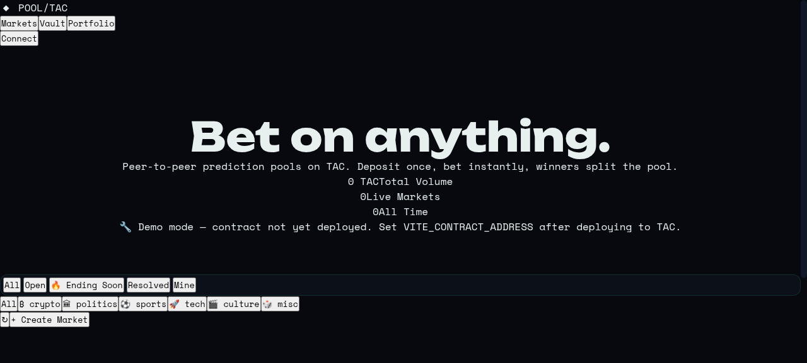

# Prediction Tac 🎯

> **Gamified peer-to-peer prediction markets on the TAC blockchain.**  
> Call it. Stake it. Win the pool. No house edge.



---

## ⚡ Overview

**Prediction Tac** is a decentralized, non-custodial prediction market dApp natively designed for both desktop web and the **Telegram Mini App (TMA)** ecosystem. Built on **TAC** (the EVM execution layer natively bridging the TON and Telegram ecosystem), Prediction Tac enables users to stake on real-world and on-chain event outcomes with transparent pari-mutuel odds, instant settlement, and zero house rake.

### Key Highlights

- **🎯 Binary & Multi-Outcome Markets**: Trade standard YES/NO predictions or multi-outcome markets (up to 8 discrete choices) with dynamic pari-mutuel odds.
- **📱 Telegram-First Experience**: Built-in Telegram Mini App SDK integration, haptic feedback, safe area insets, and Telegram TON Connect support.
- **🔐 Non-Custodial Vault Architecture**: Safe deposits, withdrawals, and escrow with reentrancy protection and verified solvency invariants.
- **⚡ Live Payout Simulator**: Instant mathematical return preview factoring in dynamically computed pool shares and protocol fees.
- **🎮 Gamification System**: On-chain and local XP, daily streaks, level progression, badges, achievements, and real-time leaderboards.
- **🎨 4 Retro-Modern Themes**: Midnight (default), Terminal (matrix-green), Degen (neon-purple), and Ledger (monochrome).
- **⌘K Command Palette**: Fast keyboard navigation across views, actions, filters, and all active markets.
- **🛡️ Admin Console**: Dedicated operational dashboard with runtime network switching (mainnet, testnet, local Anvil) without rebuilding.

---

## 🏛️ Architecture

```
Prediction Tac
├── src/                          # Foundry Smart Contracts (Solidity 0.8.24)
│   ├── PredictionPoolV3.sol      # Core V3 Protocol: Vault, Markets, Multi-Outcome, Disputes
│   └── PredictionPool.sol        # Legacy V1 Protocol
├── test/                         # Foundry Automated Test Suites
│   ├── PredictionPoolV3.t.sol    # Core V3 unit & integration tests (35 tests)
│   ├── PredictionPoolV3Features.t.sol # Feature-specific tests (6 tests)
│   └── PredictionPool.t.sol      # Legacy regression tests
├── script/                       # Deployment Scripts
│   ├── DeployV3.s.sol            # Production & testnet deploy script
│   └── Counter.s.sol
├── frontend/                     # Modern React 19 Frontend
│   ├── src/
│   │   ├── App.tsx               # Main application component & views
│   │   ├── App.css               # Core styling, animations, themes & responsive layouts
│   │   ├── abi.json              # Contract ABI interface
│   │   ├── graphics/             # Dynamic SVG pixel art & category illustrations
│   │   └── lib/                  # Preference management, sound synthesis, journal, TAC chain config
│   ├── public/                   # Static assets, manifests, icons, robots.txt, sitemap
│   ├── serve_prod.py             # Production SPA server with CSP & role routing
│   └── package.json              # Frontend dependencies (React 19, ethers v6, Vite)
├── docs/                         # Architecture, Redesign & Animation Documentation
│   ├── ANIMATION_IMPROVEMENTS.md # Context-aware animation system documentation
│   ├── DESIGN_IMPROVEMENTS.md    # UI/UX design overhaul notes
│   ├── LANDING_PAGE_FIXES.md     # Landing page & navigation documentation
│   └── REDESIGN_SUMMARY.md       # Design system comparison & summary
├── AGENTS.md                     # Technical context & protocol maintenance guide
├── CODE_REVIEW.md                # Security audit findings & hardening checklist
├── LOCAL.md                      # Local Anvil testing guide
└── foundry.toml                  # Foundry configuration (Shanghai EVM, via-ir, optimizer)
```

---

## 📜 Smart Contracts (`PredictionPoolV3.sol`)

The protocol uses a single-contract architecture managed with Foundry:

- **Vault Model**: Users deposit native TAC into the contract vault. Staking, payouts, refunds, and withdrawals occur against vault balances to minimize external gas and call-depth vulnerabilities.
- **Solvency Invariant**: Strict solvency checks verify that the contract's native balance always satisfies `contract.balance >= totalVaultBalance + totalLockedPools + accumulatedFees`.
- **Early Exit Mechanism**: Users can sell positions before market resolution with an exit fee returned to the vault.
- **Resolution & Dispute Safeguards**: Owner-resolved markets include a dispute window, timeout-based auto-refunds for abandoned markets, and emergency claim refunds.
- **Multi-Outcome Engine**: Supports markets with 2 to 8 arbitrary outcomes (`createMultiMarket`, `betOutcome`, `resolveOutcome`).
- **Batch Operations**: `claimMany` allows batch-claiming winnings across up to 32 markets in a single transaction.

---

## 🚀 Quick Start & Development

### Prerequisites

- [Node.js](https://nodejs.org/) (v18+ or v20+)
- [Foundry](https://book.getfoundry.sh/) (`forge`, `cast`, `anvil`)

### 1. Clone & Install

```bash
git clone https://github.com/instafire/prediction-tac.git
cd prediction-tac

# Install git submodules (forge-std, openzeppelin-contracts)
git submodule update --init --recursive

# Install frontend dependencies
cd frontend
npm install
```

### 2. Smart Contract Development

```bash
# Build contracts
forge build

# Run comprehensive test suite
forge test

# Run tests with detailed trace
forge test -vvv

# Format Solidity code
forge fmt
```

### 3. Frontend Development

```bash
cd frontend

# Copy environment variables
cp .env.example .env

# Run local development server
npm run dev
```

Visit `http://localhost:5173` in your browser.  
> **Note**: When `VITE_CONTRACT_ADDRESS` is `0x0000000000000000000000000000000000000000` (default), the app automatically runs in **Demo Mode**, seeding rich demo markets, mock leaders, and activity feeds.

### 4. Running with Local Anvil

```bash
# In terminal 1: start local chain
anvil

# In terminal 2: deploy contract to Anvil
forge script script/DeployV3.s.sol --rpc-url http://127.0.0.1:8545 --broadcast --private-key 0xac0974bec39a17e36ba4a6b4d238ff944bacb478cbed5efcae784d7bf4f2ff80

# In frontend/.env set:
# VITE_CHAIN=local
# VITE_TAC_RPC=http://127.0.0.1:8545
# VITE_CONTRACT_ADDRESS=<deployed-contract-address>
```

---

## 🛡️ Security & Audits

- **Pull-over-Push Payments**: Winnings and stakes credit the vault balance; users initiate withdrawals explicitly.
- **Reentrancy Protection**: OpenZeppelin `ReentrancyGuard` applied on all vault mutators.
- **Solvency Checks**: Invariant validation ensures zero undercollateralization.
- **Strict Protocol Fee Cap**: Protocol fees hard-capped at 5% maximum (`FEE_CAP = 50`).
- **Ownership Lockdown**: `renounceOwnership` is overridden and permanently disabled to protect funds in active markets.
- **Safe Frontend**: No `eval` or `dangerouslySetInnerHTML`. XSS-safe JSX rendering, strictly regex-parsed deep links, and keys never touch application memory.

Detailed security notes can be reviewed in [CODE_REVIEW.md](CODE_REVIEW.md) and [AGENTS.md](AGENTS.md).

---

## 📄 License

This project is licensed under the [MIT License](LICENSE).
